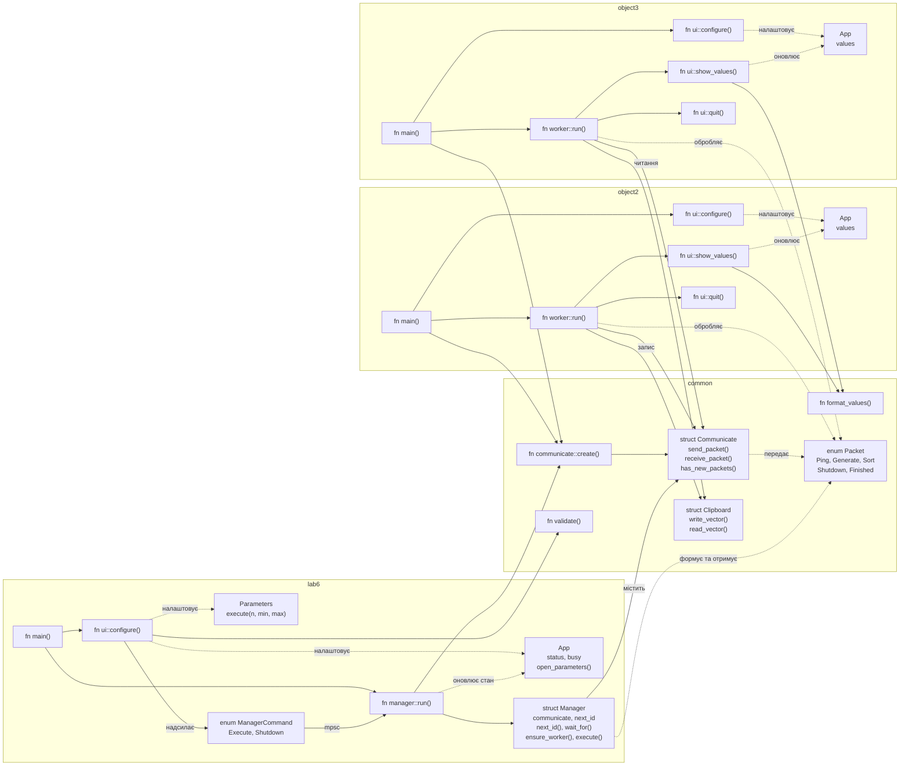

# Лабораторна робота №6. Побудування програмної системи з множини об’єктів, керованих повідомленнями

Номер у журналі 26, варіант завдання **2**.

Система складається з трьох незалежних програм:

- **Lab6** приймає параметри `n`, `Min`, `Max` і керує іншими програмами: знаходить запущені або запускає їх та надсилає команди.
- **Object2** генерує вектор із `n` дробових чисел у діапазоні від `Min` до `Max`, показує його у вікні та записує в текстовому форматі в буфер обміну.
- **Object3** зчитує вектор із буфера обміну, сортує його та показує результат у своєму вікні.

Обмін командами та відповідями відбувається через іменовані локальні сокети `interprocess`, а вектор передається через системний буфер обміну. Після виконання завдання його можна повторити; при закритті Lab6 обидва об’єкти отримують команду завершення.

## Запуск

Потрібне графічне середовище з доступним буфером обміну. Спочатку необхідно зібрати всі три програми, щоб виконувані файли об’єктів були поруч із Lab6:

```sh
cargo build --workspace
cargo run -p lab6
```

## Діаграма програми


